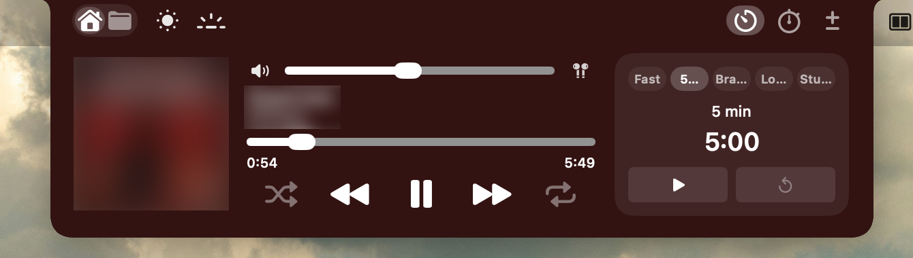
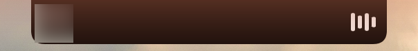
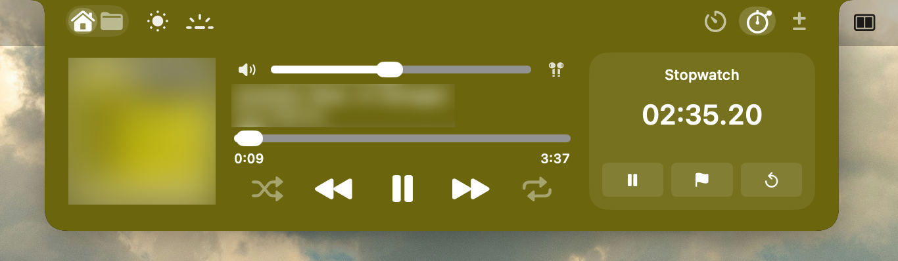
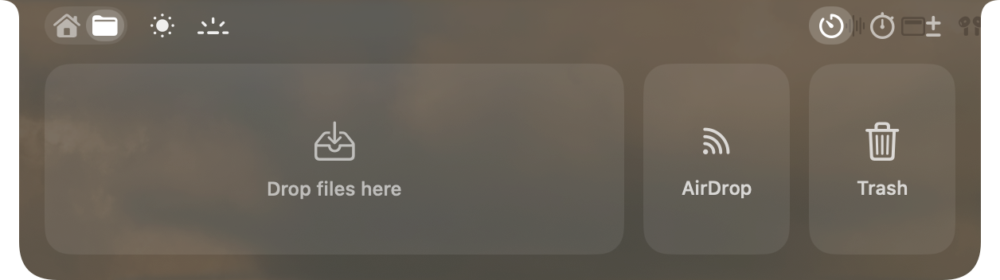

# Fonta's Dynamic Notch

A "Dynamic Island" for the MacBook notch. Closed, it shows the album cover and animated music bars (or a running timer). Hover it and it springs open into a small control panel.



| Closed | Adaptive color | Files |
|---|---|---|
|  |  |  |

## Features

- **Spotify now playing**: cover, title, artist, progress bar and playback controls
- **Audio**: system volume, mute and output-device picker
- **Brightness**: screen and keyboard backlight sliders (where macOS allows it)
- **Timers**: up to 5 concurrent timers with alarms, kept across restarts
- **Stopwatch** with laps, and named **counters**
- **Files tab**: a temporary file shelf, AirDrop and Trash drop zones
- **Fully customizable**: themes (JSON import/export), colors, corner radii, layout and module order, spring settings for every animation
- **Liquid Glass themes** (macOS 26+): the open notch can be made of Apple's Liquid Glass, morphing as it opens and closes
- Works on external displays too (draws a virtual notch)

## Requirements

- **macOS 14 Sonoma or later**, on a **Mac with a notch (Apple Silicon)**. Liquid Glass themes need **macOS 26** (blurred material before that)
- Tested on macOS 27 (MacBook Air M5) and macOS 15
- Xcode 26+ and [XcodeGen](https://github.com/yonaskolb/XcodeGen) to build
- Spotify desktop app for the music features

## Themes

Settings › Appearance lists the built-in **Default** theme plus your own. Default uses Liquid Glass (also when closed) and can be edited directly; **Reset to Original** brings back its original look, and **Duplicate** makes a separate copy. Switch its Surface to *Solid* for the classic black notch. Every theme can be exported and imported as JSON.

A theme's **Surface** is either *Solid* or *Liquid Glass*. Glass options:

- **Glass**: Regular (adapts to what's behind) or Clear (more see-through)
- **Transparency**: a Clear ↔ Tinted slider, like the one in macOS's own Appearance settings
- **Tint**: none or a colour, with an intensity. With *Use artwork colour* on, the album cover's colour tints the glass instead while music plays (your tint shows only when nothing is playing)
- **Darken for legibility**: a dark layer that keeps text readable over bright windows
- **Glass also when closed**: off by default, so the closed notch stays black like the real one

Corner rounding and shadow apply to the glass too. **Full Liquid Glass requires macOS 26.** On macOS 14 and 15, glass themes fall back to a blurred material.

## Install

1. Download `FontaDynamicNotch-0.3.zip` from the [Releases page](https://github.com/Fonta-lab/FontaDynamicNotch/releases) and unzip it.
2. Drag **FontaDynamicNotch.app** into your Applications folder.
3. The app is not notarized by Apple, so the first launch is blocked. Open it once, then go to **System Settings → Privacy & Security** and click **Open Anyway** (or right-click the app → Open).

## Build from source

The Xcode project is generated from `project.yml`.

```sh
brew install xcodegen
git clone https://github.com/Fonta-lab/FontaDynamicNotch.git
cd FontaDynamicNotch
xcodegen generate
open FontaDynamicNotch.xcodeproj
```

In `project.yml`, change `DEVELOPMENT_TEAM` to your own Apple team ID (a free Personal Team works), or switch signing to automatic in Xcode. Then build and run.

On first launch macOS will ask permission to control Spotify (Automation) and to send notifications.

## Notes

- The App Sandbox is off: Spotify scripting, brightness control and trashing files need it.
- Brightness and keyboard backlight use private macOS APIs and are hidden automatically when unavailable.

## License

[MIT](LICENSE)
